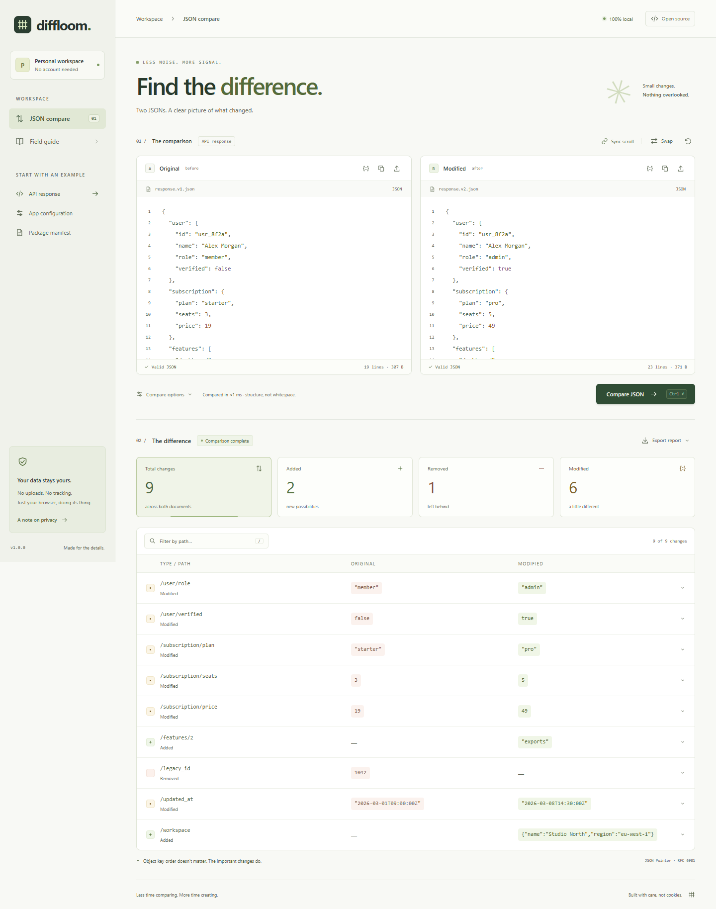

# Diffloom

**Find the change. Keep the context. Keep your data.**

Diffloom is a local-first JSON comparison workbench for the browser. Compare an API response, review a configuration change, or untangle a package manifest in a focused, side-by-side workspace—without sending your documents to a service.

[简体中文](README.zh-CN.md) · [Contributing](CONTRIBUTING.md) · [Security](SECURITY.md) · [MIT license](LICENSE)



## A workbench, not a text diff

- **Edit both sides.** Syntax-highlighted JSON editors, ready-to-use API response, configuration, and package manifest examples, plus format, import, copy, swap, and reset actions.
- **Compare when you're ready.** Use **Compare** or **Ctrl/Cmd + Enter**. Results reflect the last explicit comparison, not every keystroke.
- **Find the meaningful change.** Search JSON Pointer paths and filter change kinds. Ignore a pointer path to exclude both that exact location and its descendants.
- **Choose how arrays match.** Compare by index, or match objects by unique `id` while ignoring reordering. Missing or duplicate IDs fall back to index matching. Matched and removed entries use before-side indices; additions use after-side indices.
- **Share a focused report.** Export Markdown or JSON for the currently filtered subset. Sensitive-value redaction is checked by default for exports; it does not alter your inputs or on-screen results.

The interface is in English. Object key order is not a semantic change, and Diffloom is not a line-by-line text diff.

## Run locally

Use **Node.js 22.x (at least 22.12), 24.x, or 26 and newer**, and npm (`^22.12.0 || ^24.0.0 || >=26.0.0`). This range matches the development toolchain, including Vitest 5. From the project directory:

```sh
npm install
npm run dev
```

Open the local URL printed by Vite. Your first contributor install uses `npm install`; automated builds use `npm ci` to install the lockfile's dependency versions.

For a production build and local preview:

```sh
npm run build
npm run preview
```

The static output is written to `dist/`. No backend, account, or database is required. There are no runtime package dependencies; TypeScript, Vite, and test tools are development dependencies.

## Compare confidently

1. Paste JSON into **Before** and **After**, import files, or start with a built-in example.
2. Optionally select the array matching strategy and enter ignored JSON Pointer paths.
3. Run **Compare** (or **Ctrl/Cmd + Enter**).
4. Narrow the report by path and change kind, then export the visible subset if needed.

### Paths and array identity

Paths use [JSON Pointer](https://www.rfc-editor.org/rfc/rfc6901) notation: `/profile/name` addresses a property, `/items/0` addresses an array entry, `~1` escapes `/`, and `~0` escapes `~`. Ignoring `/profile` excludes `/profile` and everything below it, but not `/profiles`.

Index matching compares entries at the same position. Unique-`id` matching is useful for arrays of records whose ordering is incidental. IDs must be unique strings or numbers within each array; a string `"1"` and a number `1` are distinct. It ignores reorder-only changes and falls back to index matching if an entry is not an object or an ID is missing, invalid, or duplicated. Report paths for matches and removals use the original before index; new entries use their after index. Consequently, paths identify comparison locations rather than an applicable patch sequence.

### Input boundaries

Diffloom accepts **strict JSON**, not JSONC, JSON5, comments, or trailing commas. Each input is limited to **1 MiB of UTF-8 text**, with a maximum nesting depth of **128**. These guards reduce accidental oversized work; they do not guarantee that every accepted document is fast to compare. Formatting changes and object key ordering alone do not count as semantic differences.

Numbers use JavaScript's **IEEE 754 double-precision** representation, not arbitrary-precision arithmetic. Ordinary decimals are accepted and follow JavaScript's precision and rounding behavior; numerically distinct decimal literals can therefore compare equal after parsing. Diffloom rejects non-finite results (for example, `1e400`), parsed integer values outside the safe range **−9007199254740991 to 9007199254740991**, and nonzero numeric literals that underflow to zero. Encode long numeric IDs as JSON strings to preserve them exactly. This is not an arbitrary-precision numeric diff.

## Your data stays in this page

Comparison runs in your browser. The app has **no backend, accounts, analytics, or persistence**. Documents live in memory; reloading the page resets the workspace. Save anything you want to keep before navigating away. Imports read local files, and exports download files to your device.

At runtime, the app makes no network requests beyond loading its own static assets. If served from a remote host, that host still receives the normal requests for those assets. No external images, web fonts, or tracking badges are required. There is no service worker: this is not an offline-installable PWA, and a first load or reload may still need the server.

### Export redaction is a helper, not a guarantee

The export redaction checkbox is **enabled by default**. It recursively masks values under these sensitive keys in exported data:

`password`, `token`, `secret`, `api_key`, `apiKey`, `authorization`, `access_token`, `refresh_token`.

This is a limited, key-based detector. It cannot reliably identify credentials under other names, secrets embedded in ordinary strings, or sensitive information in paths and surrounding context. It affects **exports only**, not the editors, on-screen report, or ordinary copy actions. Inspect every report before sharing; never treat redaction as a complete secret scanner. See [the security policy](SECURITY.md).

## Development

| Command | Purpose |
| --- | --- |
| `npm run dev` | Start the local Vite development server |
| `npm run typecheck` | Check TypeScript without emitting files |
| `npm test` | Run Vitest unit tests |
| `npm run test:e2e` | Run Playwright browser tests |
| `npm run build` | Type-check and build production assets |
| `npm run preview` | Serve the production build locally |
| `npm run check` | Run type-check, unit tests, and production build; excludes browser tests |

Install the Chromium browser before running end-to-end tests:

```sh
npx playwright install --with-deps chromium
npm run test:e2e
```

Playwright's configured web server builds and serves the application for browser tests. The browser suite includes automated accessibility checks with axe; these checks are not a complete accessibility audit or a claim of WCAG conformance. CI runs type-check/unit/build and end-to-end checks in separate jobs on Ubuntu with Node.js 22. These are the intended verification commands, not a claim about a particular run's results.

On Windows, you can use an already installed Microsoft Edge instead of Playwright's downloaded Chromium. In PowerShell:

```powershell
$env:PLAYWRIGHT_CHANNEL = "msedge"
npm run test:e2e
```

### Capture the documentation screenshots

Build and start a preview server in one terminal:

```sh
npm run build
npm run preview -- --port 4180
```

In another terminal, from the project directory:

```sh
node scripts/capture.mjs
```

The script writes `docs/screenshot.png` and `docs/screenshot-mobile.png`. It uses `http://127.0.0.1:4180` by default; optionally set `DIFFLOOM_PREVIEW_URL` to another preview URL or `PLAYWRIGHT_CHANNEL` to `msedge` to use installed Edge. Without a channel override, install Chromium using the command above. For example, in PowerShell:

```powershell
$env:PLAYWRIGHT_CHANNEL = "msedge"
$env:DIFFLOOM_PREVIEW_URL = "http://127.0.0.1:4180"
node scripts/capture.mjs
```

### Project map

```text
src/
  main.ts          Application UI and interaction wiring
  style.css        Workbench layout and visual design
  examples.ts      Built-in comparison examples
  lib/json.ts      JSON validation and comparison logic
  lib/export.ts    Safe report generation and export redaction
tests/
  unit/            Vitest coverage of comparison behavior
  e2e/             Playwright browser journeys
```

See [CONTRIBUTING.md](CONTRIBUTING.md) for setup, behavior contracts, and pull request guidance.

## Publish to GitHub Pages

The repository name, owner, and publication decision are yours; no live repository or hosted demo is assumed here.

The [Pages workflow](.github/workflows/pages.yml) is **manual-only** (`workflow_dispatch`). In your chosen GitHub repository, enable Actions, select **GitHub Actions** as the Pages build source in **Settings → Pages**, and run **Deploy to GitHub Pages** from the Actions tab. The workflow installs locked dependencies, builds `dist/`, uploads that directory as a Pages artifact, and deploys it through the Pages environment. Follow GitHub's displayed deployment URL after a successful run; any configured environment approval still applies.

Vite's relative base, `./`, allows the generated asset URLs to work under a repository subpath as well as a domain root. You can also serve the contents of `dist/` from another static host. A web server is recommended rather than opening the HTML file directly.

## License

[MIT](LICENSE) · Copyright © 2026 Diffloom contributors.
